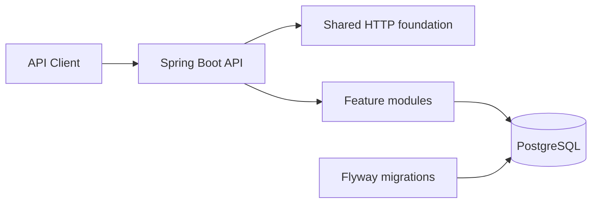

# BankCore

BankCore is a portfolio-quality, simulated online banking backend for learning backend engineering. It does not connect to banks, move real money, collect real banking credentials, or claim regulatory compliance.

Milestone 1 provides the application foundation only. Authentication and banking domain behavior are intentionally deferred.

## Architecture

BankCore starts as a feature-oriented modular monolith. PostgreSQL is the source of truth and Flyway is the only mechanism allowed to evolve its schema.



The initial package boundaries are:

```text
com.bankcore
├── auth
├── customer
├── account
├── transfer
├── transaction
├── ledger
├── notification
├── statement
├── audit
├── shared
│   ├── api
│   ├── error
│   └── web
└── config
```

Features gain `api`, `application`, `domain`, and `infrastructure` packages as their functionality is implemented. Empty layers are not created speculatively.

See [ADR-001](docs/adr/ADR-001-modular-monolith.md) for the modular-monolith decision.

## Technology

- Java 21
- Spring Boot 4.1
- Spring Web MVC, Validation, Data JPA, and Actuator
- PostgreSQL 17
- Flyway
- springdoc OpenAPI
- JUnit 5 and Testcontainers
- Maven

Kafka, Redis, Prometheus, and Grafana are deliberately absent until a milestone has a concrete use for them.

## Prerequisites

- JDK 21 or newer
- Maven 3.6.3 or newer
- Docker with Docker Compose

## Run locally

Copy `.env.example` to `.env` if you want to override the local defaults, then start PostgreSQL:

```bash
docker compose up -d postgres
```

Start the application:

```bash
mvn spring-boot:run
```

The default database connection is `jdbc:postgresql://localhost:5432/bankcore`, with local-only username `bankcore` and password `bankcore-local`. All values can be overridden with environment variables shown in `.env.example`.

Stop local infrastructure without deleting its volume:

```bash
docker compose down
```

## Endpoints

| Purpose | URL |
| --- | --- |
| Versioned API health | `GET http://localhost:8080/api/v1/health` |
| Actuator health | `GET http://localhost:8080/actuator/health` |
| Liveness | `GET http://localhost:8080/actuator/health/liveness` |
| Readiness | `GET http://localhost:8080/actuator/health/readiness` |
| OpenAPI JSON | `GET http://localhost:8080/api-docs` |
| Swagger UI | `http://localhost:8080/swagger-ui.html` |

Every HTTP response includes an `X-Request-ID`. A valid UUID supplied by the client is propagated; otherwise the API generates one.

## Error contract

Errors never expose stack traces or database messages. Validation errors add an `errors` array to this base contract:

```json
{
  "timestamp": "2026-09-08T12:00:00Z",
  "status": 400,
  "code": "VALIDATION_FAILED",
  "message": "Request validation failed.",
  "path": "/api/v1/example",
  "requestId": "3b21eb41-9e7d-4ce2-a469-65afc789bfb0",
  "errors": [
    {
      "field": "name",
      "message": "must not be blank"
    }
  ]
}
```

## Database migrations

Migrations live in `src/main/resources/db/migration`. `V1__baseline.sql` establishes schema version 1 without introducing tables owned by future feature milestones. On startup, Flyway validates and applies pending migrations before JPA initializes. Hibernate uses `ddl-auto=validate`, so it cannot mutate the schema.

## Tests

Run all tests with:

```bash
mvn verify
```

Unit/web tests cover the health contract, validation-error contract, and request-ID behavior. The application integration test starts a real PostgreSQL container and verifies that the Spring context starts and Flyway version 1 is recorded. It is skipped only when Docker is unavailable.

## Milestone 1 acceptance criteria

- [x] Spring Boot/Maven foundation targets Java 21.
- [x] Feature-first package boundaries exist.
- [x] Docker Compose defines PostgreSQL only.
- [x] Flyway runs automatically and Hibernate only validates schemas.
- [x] Versioned and Actuator health endpoints are configured.
- [x] OpenAPI/Swagger is configured.
- [x] Validation and consistent safe error responses are implemented.
- [x] Unit and PostgreSQL integration tests are present.
