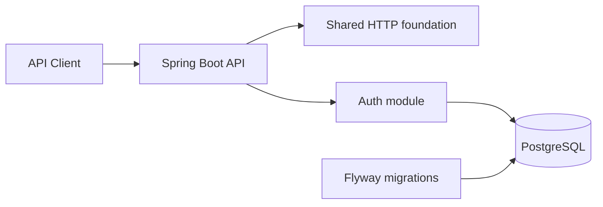

# BankCore

BankCore is a portfolio-quality, simulated online banking backend for learning backend engineering. It does not connect to banks, move real money, collect real banking credentials, or claim regulatory compliance.

Milestone 2 adds the identity and access foundation: registration, login, short-lived JWT access tokens, rotating refresh-token sessions, logout, and role-based authorization. Banking domain behavior remains intentionally deferred.

## Architecture

BankCore starts as a feature-oriented modular monolith. PostgreSQL is the source of truth and Flyway is the only mechanism allowed to evolve its schema.



The initial package boundaries are:

```text
com.bankcore
├── auth
├── customer
├── account
├── transfer
├── transaction
├── ledger
├── notification
├── statement
├── audit
├── shared
│   ├── api
│   ├── error
│   └── web
└── config
```

Features gain `api`, `application`, `domain`, and `infrastructure` packages as their functionality is implemented. Empty layers are not created speculatively.

See [ADR-001](docs/adr/ADR-001-modular-monolith.md) for the modular-monolith decision and [ADR-002](docs/adr/ADR-002-authentication-tokens.md) for the token model.

## Technology

- Java 21
- Spring Boot 4.1
- Spring Web MVC, Validation, Data JPA, Security, OAuth2 Resource Server, and Actuator
- PostgreSQL 17
- Flyway
- springdoc OpenAPI
- JUnit 5 and Testcontainers
- Maven

Kafka, Redis, Prometheus, and Grafana are deliberately absent until a milestone has a concrete use for them.

## Prerequisites

- JDK 21 or newer
- Maven 3.6.3 or newer
- Docker with Docker Compose

## Run locally

Copy `.env.example` to `.env` if you want to override the local defaults, then start PostgreSQL:

```bash
docker compose up -d postgres
```

Start the application:

```bash
mvn spring-boot:run
```

The default database connection is `jdbc:postgresql://localhost:5432/bankcore`, with local-only username `bankcore` and password `bankcore-local`. All values can be overridden with environment variables shown in `.env.example`.

The checked-in JWT secret is strictly a local-development default. Set a random secret of at least 32 UTF-8 bytes through `JWT_SECRET` in every shared or deployed environment. Access and refresh lifetimes default to 15 minutes and 30 days and can be overridden with `ACCESS_TOKEN_TTL` and `REFRESH_TOKEN_TTL`.

Stop local infrastructure without deleting its volume:

```bash
docker compose down
```

## Endpoints

| Purpose | URL |
| --- | --- |
| Versioned API health | `GET http://localhost:8080/api/v1/health` |
| Actuator health | `GET http://localhost:8080/actuator/health` |
| Liveness | `GET http://localhost:8080/actuator/health/liveness` |
| Readiness | `GET http://localhost:8080/actuator/health/readiness` |
| OpenAPI JSON | `GET http://localhost:8080/api-docs` |
| Swagger UI | `http://localhost:8080/swagger-ui.html` |
| Register | `POST http://localhost:8080/api/v1/auth/register` |
| Login | `POST http://localhost:8080/api/v1/auth/login` |
| Refresh session | `POST http://localhost:8080/api/v1/auth/refresh` |
| Logout session | `POST http://localhost:8080/api/v1/auth/logout` |
| Current identity | `GET http://localhost:8080/api/v1/auth/me` |
| ADMIN authorization check | `GET http://localhost:8080/api/v1/auth/admin-check` |

Every HTTP response includes an `X-Request-ID`. A valid UUID supplied by the client is propagated; otherwise the API generates one.

Register with an email address and a password of 12–72 characters:

```bash
curl -X POST http://localhost:8080/api/v1/auth/register \
  -H 'Content-Type: application/json' \
  -d '{"email":"alice@example.com","password":"correct horse battery staple"}'
```

Login returns a `Bearer` access token and an opaque refresh token. Send the access token as `Authorization: Bearer <token>` to protected endpoints. Refresh and logout accept `{"refreshToken":"..."}`.

## Authentication model

- Passwords are stored with BCrypt and never returned.
- Access tokens are signed HS256 JWTs containing the user ID, email, roles, issuer, token version, issue time, expiry, and unique token ID.
- Refresh tokens are 256-bit opaque random values. Only their SHA-256 hashes are persisted.
- Refreshing rotates the token under a database row lock. Reuse of a rotated token revokes its entire token family.
- Logout revokes the refresh-token family. A previously issued access token remains valid only until its short expiry unless the user is disabled or its token version changes.
- New registrations receive `CUSTOMER`; `SUPPORT` and `ADMIN` roles are seeded for later administrative workflows.

## Error contract

Errors never expose stack traces or database messages. Validation errors add an `errors` array to this base contract:

```json
{
  "timestamp": "2026-09-08T12:00:00Z",
  "status": 400,
  "code": "VALIDATION_FAILED",
  "message": "Request validation failed.",
  "path": "/api/v1/example",
  "requestId": "3b21eb41-9e7d-4ce2-a469-65afc789bfb0",
  "errors": [
    {
      "field": "name",
      "message": "must not be blank"
    }
  ]
}
```

## Database migrations

Migrations live in `src/main/resources/db/migration`. `V1__baseline.sql` establishes the baseline and `V2__create_identity_schema.sql` owns users, roles, role assignments, and refresh-token sessions. On startup, Flyway validates and applies pending migrations before JPA initializes. Hibernate uses `ddl-auto=validate`, so it cannot mutate the schema.

## Tests

Run all tests with:

```bash
mvn verify
```

Unit/web tests cover the health contract, validation-error contract, and request-ID behavior. PostgreSQL Testcontainers tests verify schema version 2 plus registration, BCrypt persistence, login failures, JWT access, role denial, refresh-token rotation and reuse detection, logout, disabled-user invalidation, and security error responses. Container-backed tests are skipped only when Docker is unavailable.

## Milestone 1 acceptance criteria

- [x] Spring Boot/Maven foundation targets Java 21.
- [x] Feature-first package boundaries exist.
- [x] Docker Compose defines PostgreSQL only.
- [x] Flyway runs automatically and Hibernate only validates schemas.
- [x] Versioned and Actuator health endpoints are configured.
- [x] OpenAPI/Swagger is configured.
- [x] Validation and consistent safe error responses are implemented.
- [x] Unit and PostgreSQL integration tests are present.

## Milestone 2 acceptance criteria

- [x] Registration normalizes email, hashes passwords, and assigns `CUSTOMER`.
- [x] Login issues a short-lived JWT and a persisted opaque refresh token.
- [x] Refresh tokens rotate atomically and reuse revokes the token family.
- [x] Logout revokes the refresh-token session.
- [x] `CUSTOMER`, `SUPPORT`, and `ADMIN` roles are modeled and JWT roles drive authorization.
- [x] Disabled users and stale token versions cannot use previously issued access tokens.
- [x] Public and protected routes return the shared safe error contract.
- [x] PostgreSQL-backed authentication integration tests pass.
