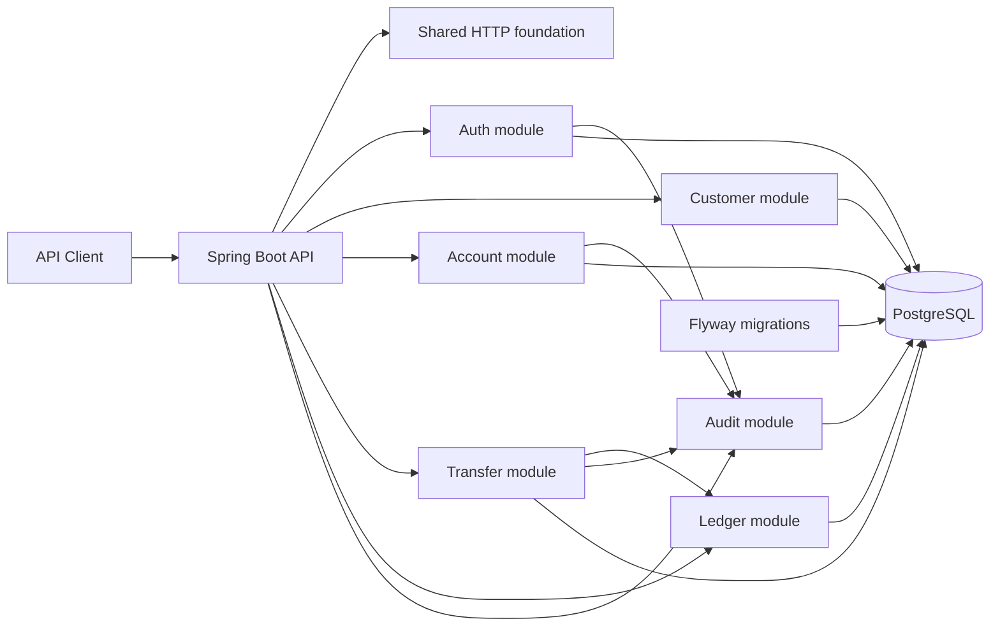
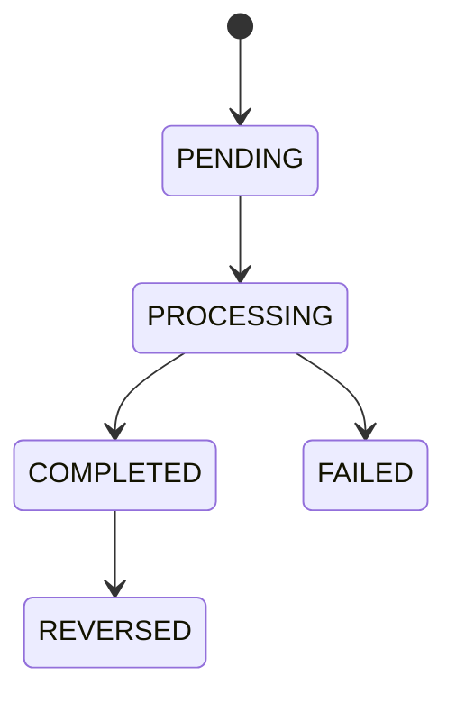
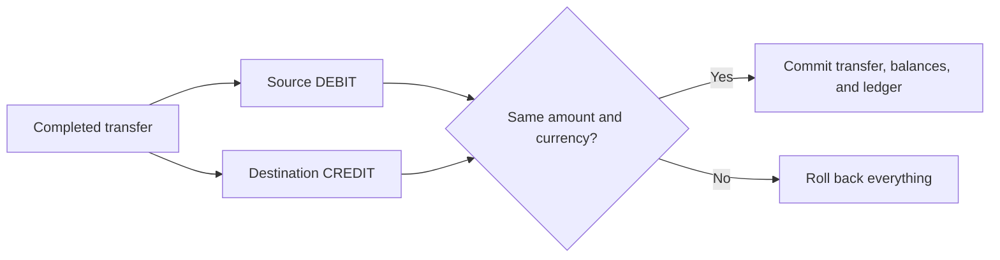

# BankCore

BankCore is a portfolio-quality, simulated online banking backend for learning backend engineering. It does not connect to banks, move real money, collect real banking credentials, or claim regulatory compliance.

Milestone 6 adds persisted transfer idempotency, deterministic concurrency control, bounded pagination, correlation-aware structured logs, and append-only security and financial audit records.

## Architecture

BankCore starts as a feature-oriented modular monolith. PostgreSQL is the source of truth and Flyway is the only mechanism allowed to evolve its schema.



The initial package boundaries are:

```text
com.bankcore
├── auth
├── customer
├── account
├── transfer
├── transaction
├── ledger
├── notification
├── statement
├── audit
├── shared
│   ├── api
│   ├── error
│   └── web
└── config
```

Features gain `api`, `application`, `domain`, and `infrastructure` packages as their functionality is implemented. Empty layers are not created speculatively.

See [ADR-001](docs/adr/ADR-001-modular-monolith.md) for the modular-monolith decision, [ADR-002](docs/adr/ADR-002-authentication-tokens.md) for the token model, [ADR-003](docs/adr/ADR-003-account-access-and-simulated-funding.md) for account access, [ADR-004](docs/adr/ADR-004-transfer-transactions.md) for transfer transaction boundaries, [ADR-005](docs/adr/ADR-005-append-only-ledger.md) for ledger invariants, [ADR-006](docs/adr/ADR-006-transfer-idempotency-and-locking.md) for transfer reliability, and [ADR-007](docs/adr/ADR-007-request-context-and-audit.md) for request context and auditing.

## Technology

- Java 21
- Spring Boot 4.1
- Spring Web MVC, Validation, Data JPA, Security, OAuth2 Resource Server, and Actuator
- PostgreSQL 17
- Flyway
- springdoc OpenAPI
- JUnit 5 and Testcontainers
- Maven

Kafka, Redis, Prometheus, and Grafana are deliberately absent until a milestone has a concrete use for them.

## Prerequisites

- JDK 21 or newer
- Maven 3.6.3 or newer
- Docker with Docker Compose

## Run locally

Copy `.env.example` to `.env` if you want to override the local defaults, then start PostgreSQL:

```bash
docker compose up -d postgres
```

Start the application:

```bash
mvn spring-boot:run
```

To expose the simulated funding endpoint during local development, opt in explicitly:

```bash
DEVELOPMENT_FUNDING_ENABLED=true mvn spring-boot:run
```

The default database connection is `jdbc:postgresql://localhost:5432/bankcore`, with local-only username `bankcore` and password `bankcore-local`. All values can be overridden with environment variables shown in `.env.example`.

The checked-in JWT secret is strictly a local-development default. Set a random secret of at least 32 UTF-8 bytes through `JWT_SECRET` in every shared or deployed environment. Access and refresh lifetimes default to 15 minutes and 30 days and can be overridden with `ACCESS_TOKEN_TTL` and `REFRESH_TOKEN_TTL`.

Stop local infrastructure without deleting its volume:

```bash
docker compose down
```

## Endpoints

| Purpose | URL |
| --- | --- |
| Versioned API health | `GET http://localhost:8080/api/v1/health` |
| Actuator health | `GET http://localhost:8080/actuator/health` |
| Liveness | `GET http://localhost:8080/actuator/health/liveness` |
| Readiness | `GET http://localhost:8080/actuator/health/readiness` |
| OpenAPI JSON | `GET http://localhost:8080/api-docs` |
| Swagger UI | `http://localhost:8080/swagger-ui.html` |
| Register | `POST http://localhost:8080/api/v1/auth/register` |
| Login | `POST http://localhost:8080/api/v1/auth/login` |
| Refresh session | `POST http://localhost:8080/api/v1/auth/refresh` |
| Logout session | `POST http://localhost:8080/api/v1/auth/logout` |
| Current identity | `GET http://localhost:8080/api/v1/auth/me` |
| ADMIN authorization check | `GET http://localhost:8080/api/v1/auth/admin-check` |
| Create customer profile | `POST http://localhost:8080/api/v1/customers` |
| Current customer profile | `GET http://localhost:8080/api/v1/customers/me` |
| Open account | `POST http://localhost:8080/api/v1/accounts` |
| List accessible accounts | `GET http://localhost:8080/api/v1/accounts` |
| Get account | `GET http://localhost:8080/api/v1/accounts/{accountId}` |
| Get balance | `GET http://localhost:8080/api/v1/accounts/{accountId}/balance` |
| Account transaction history | `GET http://localhost:8080/api/v1/accounts/{accountId}/transactions` |
| Simulated funding (opt-in) | `POST http://localhost:8080/api/v1/development/accounts/{accountId}/fund` |
| Create transfer | `POST http://localhost:8080/api/v1/transfers` |
| List visible transfers | `GET http://localhost:8080/api/v1/transfers` |
| Get transfer | `GET http://localhost:8080/api/v1/transfers/{transferId}` |

Every HTTP response includes `X-Request-ID` and `X-Correlation-ID`. Valid UUIDs supplied by the client are propagated. Missing request IDs are generated; a missing correlation ID defaults to the request ID. Both identifiers appear in structured key-value logs and durable audit records.

Register with an email address and a password of 12–72 characters:

```bash
curl -X POST http://localhost:8080/api/v1/auth/register \
  -H 'Content-Type: application/json' \
  -d '{"email":"alice@example.com","password":"correct horse battery staple"}'
```

Login returns a `Bearer` access token and an opaque refresh token. Send the access token as `Authorization: Bearer <token>` to protected endpoints. Refresh and logout accept `{"refreshToken":"..."}`.

## Authentication model

- Passwords are stored with BCrypt and never returned.
- Access tokens are signed HS256 JWTs containing the user ID, email, roles, issuer, token version, issue time, expiry, and unique token ID.
- Refresh tokens are 256-bit opaque random values. Only their SHA-256 hashes are persisted.
- Refreshing rotates the token under a database row lock. Reuse of a rotated token revokes its entire token family.
- Logout revokes the refresh-token family. A previously issued access token remains valid only until its short expiry unless the user is disabled or its token version changes.
- New registrations receive `CUSTOMER`; `SUPPORT` and `ADMIN` roles are seeded for later administrative workflows.

## Customers and accounts

An authenticated `CUSTOMER` creates one profile before opening an account. Profiles start as `ACTIVE` because BankCore does not perform real identity verification or collect identity documents. The model also supports `PENDING`, `SUSPENDED`, and `CLOSED` for later lifecycle workflows.

Accounts support `CHECKING` and `SAVINGS`, use ZAR, start at `0.00`, and receive a generated `BC`-prefixed identifier that deliberately does not mimic real bank numbering. Balances use `BigDecimal` and PostgreSQL `numeric(19,2)`. Account states are `ACTIVE`, `FROZEN`, and `CLOSED`.

Customers can list and retrieve only their own accounts. A lookup for another customer's account returns `ACCOUNT_NOT_FOUND` to avoid disclosing its existence. `SUPPORT` and `ADMIN` have explicit read access; only an owner or `ADMIN` may invoke development funding.

Development funding is disabled by default. When `DEVELOPMENT_FUNDING_ENABLED=true`, the endpoint can credit positive simulated amounts to an active account. It uses a database row lock to avoid lost updates, but it is not a deposit or real payment API and must never be enabled in a production-like environment.

## Transfer flow

A customer can transfer positive ZAR amounts from an owned active account to another active account. Source and destination must differ, both currencies must match, and the source must have sufficient funds.



The service creates the transfer, validates both accounts, debits the source, credits the destination, and completes the transfer inside one database transaction. An infrastructure failure rolls back the transfer and both balance changes. Expected business failures are recorded as `FAILED` transfers while balances remain unchanged.

For a successful transfer, the same transaction also appends one source `DEBIT` and one destination `CREDIT` to the ledger. If either entry cannot be persisted or reconciled, the transfer and both balance changes roll back.

Customers can see outgoing and incoming transfers connected to their accounts. Other customers receive `TRANSFER_NOT_FOUND`; `SUPPORT` and `ADMIN` have explicit read access. Account versions remain a stale-write guard, while Milestone 6 pessimistic locks provide the transfer concurrency policy described below.

## Idempotency and concurrency

`POST /api/v1/transfers` requires an `Idempotency-Key` containing 1–128 letters, digits, `.`, `_`, `:`, or `-`. The key is scoped to the authenticated user. A successful retry with the same key and request returns the original transfer with `Idempotency-Replayed: true`; a failed retry returns the original stable business error. Using the key for different input returns `409 IDEMPOTENCY_KEY_REUSED`.

```bash
curl -X POST http://localhost:8080/api/v1/transfers \
  -H 'Authorization: Bearer <token>' \
  -H 'Idempotency-Key: 774fc74c-4306-4415-86d8-f17b51192ee1' \
  -H 'Content-Type: application/json' \
  -d '{"sourceAccountId":"<uuid>","destinationAccountId":"<uuid>","amount":250.00,"currency":"ZAR","description":"Transfer"}'
```

PostgreSQL advisory transaction locks serialize concurrent requests using the same user/key pair. The source and destination account rows are then locked pessimistically in UUID order. Concurrent transfers sharing an account consequently validate against the latest committed balance, and deterministic ordering avoids lock-order deadlocks. Transfer state, balance changes, ledger postings, idempotency outcome, and audit record still share one transaction.

## Ledger and account transactions

The ledger is the immutable financial-history record for completed transfers. Stored account balances remain the fast current-state projection, while account transaction history is derived from ledger postings joined to transfer descriptions and references.



Every posting must contain exactly two entries for distinct accounts, with one debit and one credit of the same positive amount and currency. PostgreSQL checks the final posting with deferred constraint triggers at transaction commit and rejects ledger rows for transfers that are not completed. Hibernate treats entries as immutable, and PostgreSQL rejects all ledger updates and deletes.

`GET /api/v1/accounts/{accountId}/transactions` returns newest-first postings for an owned account; `SUPPORT` and `ADMIN` retain their explicit read access. Failed transfers do not appear because no funds moved. Development funding is deliberately excluded because it is opt-in test setup rather than a deposit transaction.

## Pagination

Account lists, transfer lists, and account transaction history accept zero-based `page` and `size` query parameters. The default size is 20 and the maximum is 100. Responses use a stable envelope:

```json
{
  "content": [],
  "page": 0,
  "size": 20,
  "totalElements": 0,
  "totalPages": 0,
  "first": true,
  "last": true
}
```

Accounts are ordered oldest-first; transfers and ledger transactions are ordered newest-first with UUID tie-breakers.

## Audit and structured logging

Audit rows are appended for `LOGIN_SUCCESS`, `LOGIN_FAILED`, `ACCOUNT_CREATED`, `TRANSFER_COMPLETED`, and `TRANSFER_FAILED`. They store controlled metadata and request/correlation identifiers but never passwords, authorization headers, access tokens, or refresh tokens. Hibernate exposes no mutation workflow and PostgreSQL rejects audit updates and deletes.

Request completion, login outcomes, and transfer outcomes use consistent key-value logs with `service`, `requestId`, and `correlationId`. Logs are operational diagnostics; the PostgreSQL audit table is the durable business/security record.

## Error contract

Errors never expose stack traces or database messages. Validation errors add an `errors` array to this base contract:

```json
{
  "timestamp": "2026-09-08T12:00:00Z",
  "status": 400,
  "code": "VALIDATION_FAILED",
  "message": "Request validation failed.",
  "path": "/api/v1/example",
  "requestId": "3b21eb41-9e7d-4ce2-a469-65afc789bfb0",
  "errors": [
    {
      "field": "name",
      "message": "must not be blank"
    }
  ]
}
```

## Database migrations

Migrations live in `src/main/resources/db/migration`. `V1` establishes the baseline, `V2` owns identity data, `V3` owns customers/accounts, `V4` owns transfers, `V5` owns immutable ledger entries and reconciliation, and `V6__create_reliability_schema.sql` owns idempotency and append-only audit records. On startup, Flyway validates and applies pending migrations before JPA initializes. Hibernate uses `ddl-auto=validate`, so it cannot mutate the schema.

## Tests

Run all tests with:

```bash
mvn verify
```

The 44 unit, web, and PostgreSQL Testcontainers tests cover schema version 6, authentication, customers/accounts, transfer and ledger invariants, rollback, sequential and simultaneous idempotency retries, payload conflicts, competing withdrawals, pagination bounds, correlation propagation, audit atomicity, and audit immutability. Container-backed tests are skipped only when Docker is unavailable.

## Milestone 1 acceptance criteria

- [x] Spring Boot/Maven foundation targets Java 21.
- [x] Feature-first package boundaries exist.
- [x] Docker Compose defines PostgreSQL only.
- [x] Flyway runs automatically and Hibernate only validates schemas.
- [x] Versioned and Actuator health endpoints are configured.
- [x] OpenAPI/Swagger is configured.
- [x] Validation and consistent safe error responses are implemented.
- [x] Unit and PostgreSQL integration tests are present.

## Milestone 2 acceptance criteria

- [x] Registration normalizes email, hashes passwords, and assigns `CUSTOMER`.
- [x] Login issues a short-lived JWT and a persisted opaque refresh token.
- [x] Refresh tokens rotate atomically and reuse revokes the token family.
- [x] Logout revokes the refresh-token session.
- [x] `CUSTOMER`, `SUPPORT`, and `ADMIN` roles are modeled and JWT roles drive authorization.
- [x] Disabled users and stale token versions cannot use previously issued access tokens.
- [x] Public and protected routes return the shared safe error contract.
- [x] PostgreSQL-backed authentication integration tests pass.

## Milestone 3 acceptance criteria

- [x] Authenticated users can create and retrieve one customer profile.
- [x] Active customers can open `CHECKING` and `SAVINGS` accounts in ZAR.
- [x] Accounts expose system-generated simulated numbers, balances, status, and version.
- [x] Customers can list, retrieve, and inspect balances only for owned accounts.
- [x] `SUPPORT` and `ADMIN` have explicit account read access.
- [x] Development funding is disabled by default, ownership-aware, and rejects inactive accounts.
- [x] Database constraints enforce statuses, currencies, non-negative balances, relationships, and uniqueness.
- [x] PostgreSQL-backed customer/account integration tests pass.

## Milestone 4 acceptance criteria

- [x] Customers can create simulated ZAR transfers from owned accounts.
- [x] Source debit, destination credit, and transfer completion share one transaction.
- [x] Insufficient funds and inactive accounts leave balances unchanged.
- [x] Transfer states enforce valid transitions and reject invalid transitions.
- [x] Source/destination, amount, currency, ownership, and account status are validated.
- [x] Outgoing and incoming transfer history respects account ownership.
- [x] Database constraints enforce positive amounts, distinct accounts, states, and failure/completion fields.
- [x] Unit and PostgreSQL integration tests prove success, failure, and rollback behavior.

## Milestone 5 acceptance criteria

- [x] Every completed transfer atomically appends one source debit and one destination credit.
- [x] Debit and credit amounts, currencies, transfer IDs, and distinct accounts must balance.
- [x] Hibernate models ledger entries as immutable and PostgreSQL rejects updates and deletes.
- [x] Deferred database reconciliation prevents completed transfers with missing or invalid postings.
- [x] Failed transfers and rolled-back transfers leave no ledger entries.
- [x] Account transaction history is derived from ledger postings and respects account ownership.
- [x] Database indexes support transfer reconciliation and newest-first account history.
- [x] Unit and PostgreSQL integration tests prove ledger invariants, immutability, authorization, and rollback.

## Milestone 6 acceptance criteria

- [x] Transfer creation requires a persisted, user-scoped idempotency key and request fingerprint.
- [x] Sequential and concurrent duplicate requests return one original transfer without moving funds twice.
- [x] Reusing a key with different input returns a stable conflict error.
- [x] Deterministically ordered pessimistic account locks prevent concurrent overdrafts.
- [x] Account, transfer, and ledger-history collections return bounded page envelopes.
- [x] Request and correlation IDs propagate through response headers, MDC logs, and audit rows.
- [x] Login, account-creation, and transfer outcomes create safe structured audit records.
- [x] PostgreSQL prevents audit records from being updated or deleted.
- [x] PostgreSQL concurrency tests prove idempotency and balance integrity under simultaneous requests.
