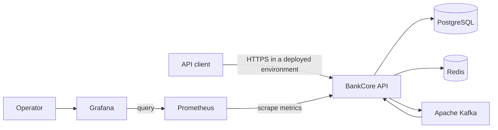
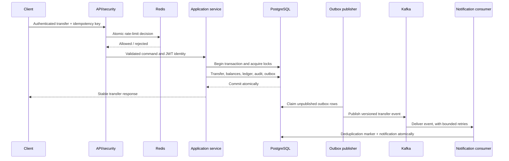
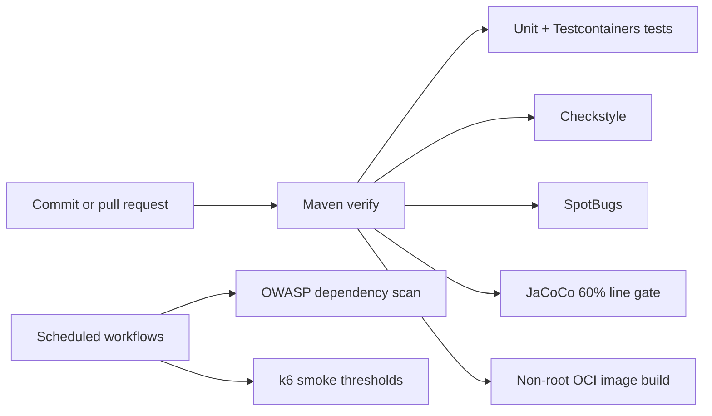

# BankCore architecture

## Purpose and scope

BankCore is a simulated online-banking backend for engineering practice. It models identity, customer profiles, accounts, transfers, an append-only ledger, audit history, reliable event delivery, rate limiting, and operational telemetry. It does not connect to payment rails, hold real funds, collect real banking credentials, or provide a production banking or compliance platform.

The application is a feature-oriented modular monolith. One Spring Boot process owns the HTTP API, business workflows, scheduled outbox publishing, and Kafka notification consumer. PostgreSQL is the system of record. Redis is short-lived coordination state, while Kafka carries committed domain events to asynchronous consumers.

## System context

Compose provides this topology for local development and CI smoke tests. The checked-in defaults, credentials, and unencrypted container network are local-only.

## Application boundaries

| Module | Responsibility | Owned persistent data |
| --- | --- | --- |
| `auth` | Registration, login, JWT access tokens, refresh rotation, logout, authorization identity | users, roles, refresh tokens |
| `customer` | Customer profile lifecycle | customers |
| `account` | Account lifecycle, authorization, balances, simulated funding | accounts |
| `transfer` | Transfer validation, state transitions, idempotency, and account locking | transfers, idempotency outcomes |
| `ledger` | Immutable double-entry postings and account transaction history | ledger entries |
| `audit` | Durable security and business audit events | audit records |
| `messaging` | Transactional outbox publishing and consumer deduplication | outbox events, processed-event markers |
| `notification` | Internal effects derived from transfer events | notifications |
| `ratelimit` | Distributed fixed-window abuse controls | expiring Redis counters only |
| `observability` | Metrics and dependency health indicators | no business data |
| `shared` | HTTP context, stable errors, paging, and cross-cutting primitives | none |

Feature packages separate API, application, domain, and infrastructure concerns where those layers contain behavior. Cross-module work is coordinated through application services rather than controllers or repositories reaching into another module's internals.

## Runtime request path

PostgreSQL advisory locks serialize the same user/idempotency key. Account rows are pessimistically locked in deterministic UUID order, preventing lost updates and lock-order deadlocks. A completed transfer, its two balanced ledger entries, balance changes, idempotency result, audit record, and outbox event commit together.

Outbox publication and Kafka consumption are at least once. A publisher crash can produce a duplicate after Kafka accepts a record, so consumers insert a unique consumer/event marker in the same transaction as their effects. Poison records receive bounded retries and then move to a dead-letter topic.

## Data and consistency rules

- Flyway exclusively evolves the schema; Hibernate validates it with `ddl-auto=validate`.
- PostgreSQL is authoritative for financial and delivery state. Redis never stores balances, transfers, identity, ledger, or audit data.
- Account balances use fixed-scale decimal values and are a current-state projection. The immutable ledger is the financial history for completed transfers.
- Deferred PostgreSQL constraints verify that completed transfers have one matching debit and credit before commit.
- PostgreSQL rejects ledger and audit updates or deletes.
- API collection reads use bounded pagination and stable ordering.

## Security and privacy boundaries

- Passwords are BCrypt hashes; opaque refresh-token values are represented only by SHA-256 hashes at rest.
- Short-lived HS256 access tokens carry a user ID, roles, issuer, token version, timestamps, and token ID. Deployed environments must supply a strong external secret.
- Controllers derive identity and roles from validated JWT claims rather than client input.
- Authorization hides inaccessible customer resources behind not-found responses where disclosure would be unsafe.
- Errors exclude stack traces, database messages, tokens, and secrets. Audit metadata is controlled rather than arbitrary request content.
- Rate-limit keys hash identifiers, and metric labels use bounded values to avoid exposing identities or creating unbounded cardinality.
- The local metrics endpoint is unauthenticated for Compose scraping; deployed environments must restrict it at the network boundary.

## Availability and observability

Liveness reports whether the application process can run and does not depend on external services. Readiness includes PostgreSQL and includes Redis or Kafka when their associated features are enabled. An unavailable enabled rate limiter fails protected requests closed rather than silently bypassing the control.

Micrometer exports JVM, HTTP, connection-pool, transfer, outbox, Kafka-consumer, and rate-limit metrics. Prometheus scrapes the API and Grafana is provisioned with the local data source and overview dashboard. Request and correlation IDs connect HTTP responses, structured logs, audit rows, and event envelopes.

## Build and delivery

The multi-stage Dockerfile compiles with Java 21 and copies only the executable jar into a JRE image. The runtime uses an unprivileged `bankcore` account and exposes a readiness health check through Compose. CI builds but does not publish the image; registry choice, signing, provenance policy, and deployment promotion remain environment-specific decisions.

## Deployment assumptions and known gaps

The repository demonstrates production-oriented engineering controls, not a complete production banking environment. A real deployment still requires:

- TLS termination, private service networking, firewall policy, secret management, and credential rotation;
- a highly available managed database, Kafka, and Redis design with backup, restore, retention, and disaster-recovery testing;
- image signing, registry policy, software-bill-of-materials handling, deployment manifests, and controlled promotion/rollback;
- alert routing, service-level objectives, centralized logs, tracing, capacity testing, and incident runbooks;
- identity verification, payment-rail integration, reconciliation operations, fraud controls, regulatory analysis, and independent security review.

Architecture decisions are recorded under [`docs/adr`](adr/). ADRs describe the trade-offs behind the modular boundaries, security model, transaction semantics, event delivery, observability, and production quality gates.
